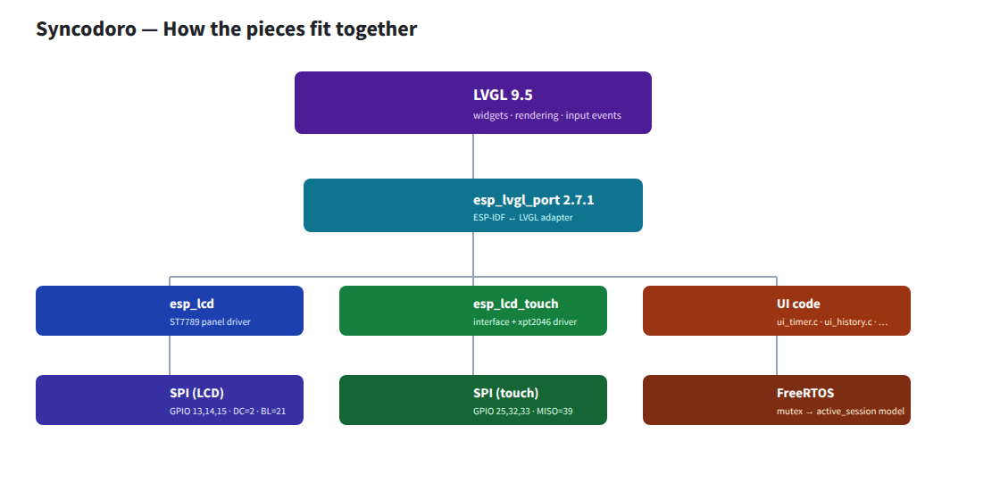

# Syncodoro — Dependency Reference

*What each dependency is, why Syncodoro uses it, how it's wired in, and where to learn more.*

---

## Two layers of dependencies

This project pulls in dependencies from **two different places**:

1. **ESP-IDF built-in components** — shipped with the ESP-IDF framework itself (FreeRTOS, WiFi, HTTP server, flash storage...). Declared in `main/CMakeLists.txt` under `PRIV_REQUIRES`.
2. **Registry components** — third-party (or Espressif-published) components fetched from the [Espressif Component Registry](https://components.espressif.com). Declared in `main/idf_component.yml` and downloaded into `managed_components/` at build time.

`dependencies.lock` is the lockfile — it pins the exact resolved versions (IDF v6.2.0, LVGL 9.5.0, etc.).

---

## Layer 1 — Registry components (from `idf_component.yml`)

### `espressif/esp_lvgl_port` — v2.7.1

- **What:** Espressif's adapter ("port") between ESP-IDF and the LVGL graphics library. It knows how to take an ESP-IDF LCD panel + touch controller and present them to LVGL as a display and an input device.
- **Why:** LVGL doesn't know (or care) that your screen is an SPI panel. The port layer does the boring wiring: creating the LVGL display object, feeding it a draw buffer, and forwarding touch coordinates as input events.
- **How:** `main/main.c:14` includes `esp_lvgl_port.h`; `main/bsp/cyd.c` calls `lvgl_port_init()`, then `lvgl_port_add_disp()` (display) and `lvgl_port_add_touch()` (touch) around lines 213–244.
- **Links:** [GitHub (esp-bsp)](https://github.com/espressif/esp-bsp/tree/master/components/esp_lvgl_port) · [Registry page](https://components.espressif.com/components/espressif/esp_lvgl_port)
- **Pulls in:** `lvgl/lvgl` (see below) as a `public` dependency — which is why LVGL appears in the lockfile even though we never list it directly.

### `lvgl/lvgl` — v9.5.0 *(transitive)*

- **What:** The [LVGL](https://lvgl.io) widget library itself — buttons, labels, arcs, rollers, themes, input handling, rendering. (See the "What is LVGL?" callout in the developer log.)
- **Why:** Syncodoro's entire UI (timer arc, `mm:ss` label, tag, status, modals) is LVGL widgets.
- **How:** Not named directly in `idf_component.yml` — pulled in automatically by `esp_lvgl_port`. Fonts used by the UI are enabled in `sdkconfig.defaults` (`CONFIG_LV_FONT_MONTSERRAT_16` / `_48`).
- **Links:** [lvgl.io](https://lvgl.io) · [GitHub](https://github.com/lvgl/lvgl) · [Docs](https://docs.lvgl.io/)

### `espressif/esp_lcd_ili9341` — v2.0.2

- **What:** ESP-IDF driver component for the **ILI9341** LCD controller.
- **Why:** Some "Cheap Yellow Display" units ship an ILI9341 panel rather than the ST7789. Declaring the component keeps that board variant buildable.
- **How:** Currently the code path in `main/bsp/cyd.c` uses `esp_lcd_new_panel_st7789()` (ST7789), so on this board the ILI9341 component is a **declared-but-unused** dependency — kept for the alternate panel variant. Worth a cleanup pass or a Kconfig option if only one panel will ever be used.
- **Links:** [Registry page](https://components.espressif.com/components/espressif/esp_lcd_ili9341)
- **Pulls in:** `espressif/cmake_utilities` (build helpers).

### `atanisoft/esp_lcd_touch_xpt2046` — v1.0.6

- **What:** SPI driver for the **XPT2046** resistive touch controller.
- **Why:** The CYD's touchscreen is an XPT2046 on its own SPI bus; without a driver, taps never reach LVGL.
- **How:** `main/bsp/cyd.c:19` includes `esp_lcd_touch_xpt2046.h`; `esp_lcd_touch_new_spi_xpt2046()` (line 165) creates the touch device that `lvgl_port_add_touch()` consumes.
- **Links:** [GitHub](https://github.com/atanisoft/esp_lcd_touch_xpt2046) · [Registry page](https://components.espressif.com/components/atanisoft/esp_lcd_touch_xpt2046)
- **Pulls in:** `espressif/esp_lcd_touch` (touch abstraction interface).

### `espressif/esp_lcd_touch` — v1.2.1 *(transitive)*

- **What:** Espressif's common touchscreen interface that concrete drivers (like the XPT2046 one) implement.
- **Why:** Lets the port layer talk to *any* touch chip through one API.
- **How:** Purely an interface — pulled in by the XPT2046 driver, consumed by `esp_lvgl_port`.
- **Links:** [Registry page](https://components.espressif.com/components/espressif/esp_lcd_touch)

---

## Layer 2 — ESP-IDF built-in components (from `PRIV_REQUIRES`)

These all ship inside ESP-IDF; docs live at [docs.espressif.com](https://docs.espressif.com/projects/esp-idf/en/latest/esp32/index.html).

### `freertos` — v? (part of IDF)

- **What:** [FreeRTOS](https://www.freertos.org/), the real-time kernel ESP-IDF is built on. (See the "What is FreeRTOS?" callout.)
- **Why:** ESP-IDF runs everything as FreeRTOS tasks; Syncodoro uses its mutexes (`xSemaphoreCreateMutex`) to guard the timer model.
- **How:** Added to `PRIV_REQUIRES` when the model gained the mutex-guarded control API, so `freertos/semphr.h` is linkable from `pomo_model.c`.
- **Links:** [freertos.org](https://www.freertos.org/) · [IDF docs](https://docs.espressif.com/projects/esp-idf/en/latest/esp32/api-reference/system/freertos.html)

### `esp_lcd`

- **What:** ESP-IDF's LCD panel framework (panel, panel I/O, vendor drivers like ST7789).
- **Why:** The CYD's 240x320 display. `cyd.c` uses `esp_lcd_new_panel_io_spi()` and `esp_lcd_new_panel_st7789()`.
- **How:** `PRIV_REQUIRES`; includes `esp_lcd_panel_io.h`, `esp_lcd_panel_ops.h`, `esp_lcd_panel_vendor.h`.

### `nvs_flash`

- **What:** Non-Volatile Storage — a tiny key-value store in flash.
- **Why:** Persists WiFi credentials and tags so they survive reboots and reflashes (unless NVS is erased).
- **How:** `config/nvs_config.c` wraps it (`nvs_config_get_wifi_ssid`, `nvs_config_get_tags`, ...).

### `esp_timer`

- **What:** ESP-IDF's high-resolution software timer service (microsecond resolution).
- **Why:** Generates session IDs from uptime (`esp_timer_get_time()` in `ui_timer.c`) and drives timing needs.
- **How:** `ui_timer.c` calls `esp_timer_get_time()` when saving a completed session.

### `spiffs`

- **What:** A lightweight filesystem in flash (SPI Flash File System).
- **Why:** Session history is saved as CSV files; config as JSON.
- **How:** `storage/session_csv.c` and `storage/config_json.c`; partition layout in `partitions.csv` (spiffs @ 0x200000, 1.5MB).

### `esp_wifi` + `esp_netif` + `esp_event`

- **What:** WiFi driver / network interface abstraction / event loop.
- **Why:** STA + AP modes, IP assignment (now a fixed static IP), and connection/disconnection event handling.
- **How:** `network/wifi_manager.c` uses `esp_wifi_*`, `esp_netif_*` (incl. `esp_netif_set_ip_info()` for the static IP), and the ESP event loop for `WIFI_EVENT_*` / `IP_EVENT_STA_GOT_IP`.

### `esp_http_server`

- **What:** ESP-IDF's embedded HTTP server (`esp_http_server`).
- **Why:** The web dashboard, CSV download, tag management, and the new webhook API endpoints.
- **How:** `network/http_server.c` — `httpd_start()`, `httpd_register_uri_handler()`, and the `max_uri_handlers` config raised to 12. The `CONFIG_HTTPD_MAX_REQ_HDR_LEN=2048` in `sdkconfig.defaults` widens the request header buffer for modern browsers.

### `esp_system`

- **What:** Core ESP32 system services (system init, restart, etc.).
- **How:** Provides the base system APIs the app and the IDF components above rely on.

---

## How the pieces fit together

> [!NOTE] Editable source
> The diagram above is also maintained as a vector board (**"Syncodoro Architecture"**) in the Penpot design file, so it can be re-arranged there and re-exported to `docs/syncodoro-architecture.svg`.

Display/touch chain: `esp_lcd` + `esp_lcd_touch_xpt2046` → `esp_lvgl_port` → LVGL → your UI callbacks.
State safety: HTTP server task and LVGL task both touch `active_session` through a FreeRTOS mutex (`freertos`).

---

## Quick reference

| Dependency | Layer | Version | Role | Where declared |
|---|---|---|---|---|
| `espressif/esp_lvgl_port` | Registry | 2.7.1 | ESP-IDF ↔ LVGL adapter | `idf_component.yml` |
| `lvgl/lvgl` | Registry (transitive) | 9.5.0 | GUI widgets/rendering | via esp_lvgl_port |
| `espressif/esp_lcd_ili9341` | Registry | 2.0.2 | Alternate LCD driver (unused on ST7789 build) | `idf_component.yml` |
| `atanisoft/esp_lcd_touch_xpt2046` | Registry | 1.0.6 | XPT2046 touch driver | `idf_component.yml` |
| `espressif/esp_lcd_touch` | Registry (transitive) | 1.2.1 | Touch abstraction | via xpt2046 driver |
| `esp_lcd` | IDF built-in | — | LCD panel framework + ST7789 | `PRIV_REQUIRES` |
| `freertos` | IDF built-in | — | RTOS tasks + mutexes | `PRIV_REQUIRES` |
| `nvs_flash` | IDF built-in | — | Key-value persistence (WiFi/tags) | `PRIV_REQUIRES` |
| `esp_timer` | IDF built-in | — | Microsecond timers / uptime | `PRIV_REQUIRES` |
| `spiffs` | IDF built-in | — | CSV/JSON filesystem | `PRIV_REQUIRES` |
| `esp_wifi` | IDF built-in | — | WiFi STA/AP | `PRIV_REQUIRES` |
| `esp_netif` | IDF built-in | — | Network interfaces (static IP) | `PRIV_REQUIRES` |
| `esp_event` | IDF built-in | — | WiFi/IP event loop | `PRIV_REQUIRES` |
| `esp_http_server` | IDF built-in | — | Dashboard + webhook API | `PRIV_REQUIRES` |
| `esp_system` | IDF built-in | — | Core system services | `PRIV_REQUIRES` |

> [!NOTE] Direct vs transitive
> "Direct" = you name it in your manifest (`idf_component.yml`) or `PRIV_REQUIRES`. "Transitive" = a direct dependency needs it, so the component manager resolves it for you — you still see it in `dependencies.lock`, but you don't (and usually shouldn't) pin it yourself.

> [!NOTE] Cleanup candidate
> `espressif/esp_lcd_ili9341` is declared but the active code path drives an ST7789 panel. It's only needed if you build the ILI9341 variant — see README's "Display driver" section. The version pins live in `dependencies.lock`; delete the file + `managed_components/` and rebuild to refresh them.

---

## Other project-level tools

- **`flash.sh`** — build/flash/monitor helper; relies on your IDF environment (`$IDF_PATH`).
- **`syncodoro`** — LAN CLI; the only runtime dependency is `curl` (plus `python3` for pretty JSON output).
- **Web-flash tooling** — `docs/index.html` + `docs/manifest.json` describe the firmware binary layout for ESP Web Flash Tool.
