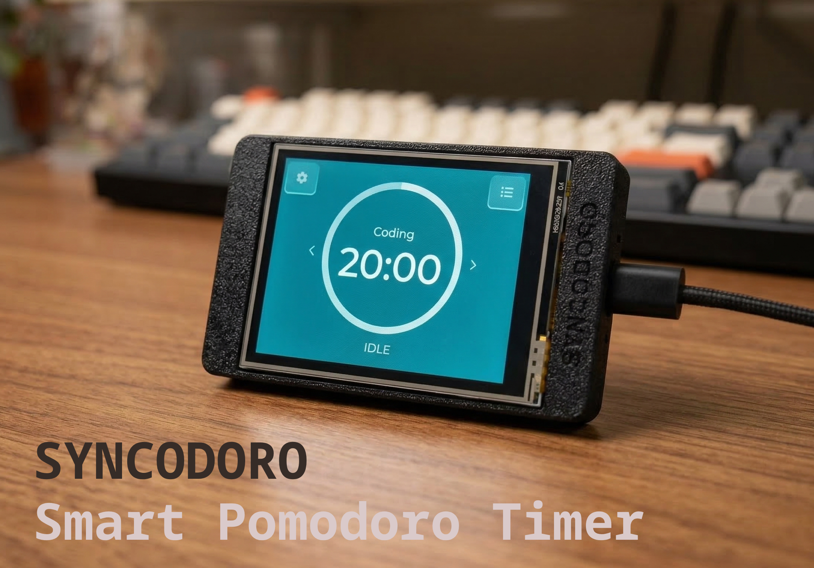
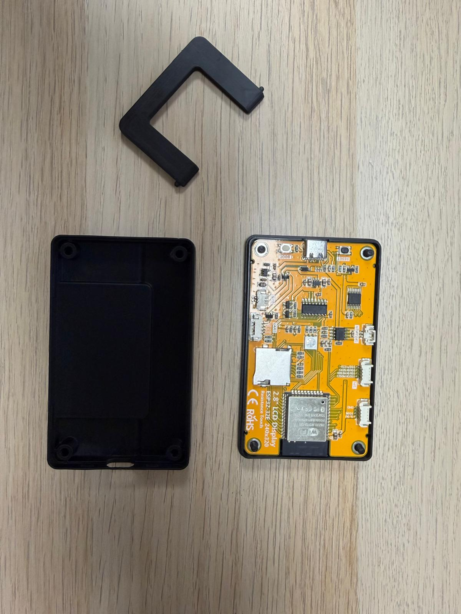
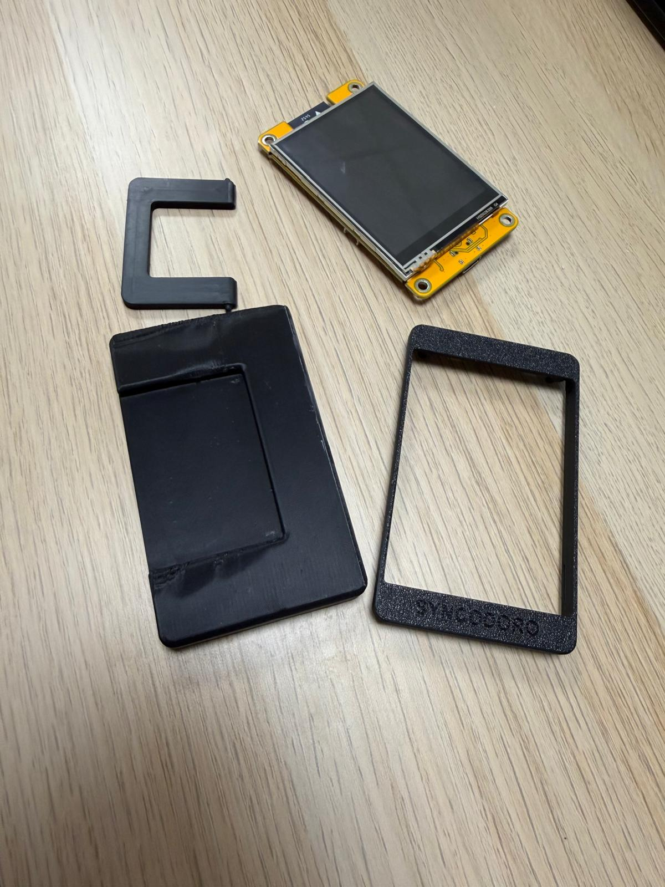

# Syncodoro



A standalone **Pomodoro focus timer** for the ESP32-2432S028R ("Cheap Yellow Display") — 2.8" resistive touchscreen, SPIFFS session logging, NTP time sync, and a local web dashboard for managing tags and reviewing history.

---

## Features

| Feature | Details |
|---|---|
| **Touchscreen UI** | LVGL dark theme, circular arc progress, tap-to-start/pause; four colour themes (Dark, Forest, Ocean, Warm) |
| **Focus sessions** | Duration 5–120 min (5-min steps); tag selected from a list synced with the web dashboard |
| **Session logging** | Completed sessions appended to `/data/sessions.csv` on SPIFFS — no SD card required |
| **Timestamps** | NTP sync after WiFi connect; start time stored in UTC |
| **On-device history** | Scrollable session list: tag, duration, date/time |
| **Web dashboard** | History table, CSV download, and tag management (add/remove, save to device) |
| **WiFi modes** | AP mode on first boot (`Syncodoro-Setup` → 192.168.4.1); STA mode for normal use |

---

## Hardware

**Target board:** [ESP32-2432S028R](https://github.com/witnessmenow/ESP32-Cheap-Yellow-Display) — commonly called the "CYD"

**Display driver:** Supports both **ST7789** (default) and **ILI9341**. Select via `idf.py menuconfig` → Syncodoro Configuration, or choose in [docs/index.html](docs/index.html) for web flashing.

### Pin Map

| Peripheral | Signal | GPIO |
|---|---|---|
| **LCD (SPI2)** | MOSI | 13 |
| | MISO | 12 |
| | SCLK | 14 |
| | CS | 15 |
| | DC | 2 |
| | Backlight | 21 |
| **Touch (SPI3)** | MOSI | 32 |
| | MISO | 39 |
| | SCLK | 25 |
| | CS | 33 |
| **SD (shared SPI2)** | CS | 4 |

### 3D-Printed Case

An optional snap-fit enclosure is available on [MakerWorld](https://makerworld.com/en/models/2546010-syncodoro#profileId-2803501) and in [`mechanical/syncodoro_case_no_screw.stp`](mechanical/syncodoro_case_no_screw.stp) — a single STEP file with three bodies: bottom shell, display bezel, and USB access clip.




| Setting | Value |
|---|---|
| Material | PLA or PETG |
| Layer height | 0.2 mm |
| Infill | 20 % |
| Supports | Not required |

---

## Building & Flashing

### Requirements

- [ESP-IDF v5.4.x](https://docs.espressif.com/projects/esp-idf/en/v5.4/esp32/get-started/)
- Python 3.x
- USB cable to the ESP32-2432S028R

### Build & Flash

```bash
cd syncodoro

# Set up IDF environment (Windows PowerShell)
. $env:IDF_PATH\export.ps1

# Build (ST7789 default)
idf.py build
idf.py -p COM<PORT> flash monitor

# ILI9341 variant
idf.py -DSDKCONFIG_DEFAULTS="sdkconfig.defaults;sdkconfig.defaults.ili9341" fullclean build
idf.py -p COM<PORT> flash
```

> If flashing over a previous project, run `idf.py -p COM<PORT> erase-flash` first — the project uses a custom 4 MB partition table.

### WiFi Setup

On first boot the device starts in **AP mode**: connect to `Syncodoro-Setup` (open network) and open `http://192.168.4.1` to enter your home WiFi credentials. After saving, it reboots into **STA mode** and joins your network. The Settings screen shows the assigned IP; open `http://<device-ip>` to access the web dashboard.

To reset WiFi credentials, erase NVS with `idf.py -p COM<PORT> erase-flash` and re-flash.

---

## Project Structure

```
syncodoro/
├── hardware/               # Photos and product assets
├── mechanical/             # 3D-print case STEP file
├── docs/                   # Web installer and partition binary
├── partitions.csv          # Custom 4 MB flash layout
└── main/
    ├── main.c              # Boot entry — NVS read, BSP init, mode branch
    ├── bsp/                # ST7789/ILI9341 LCD + XPT2046 touch init
    ├── model/              # pomoTimer_t struct, global active_session
    ├── config/             # NVS: WiFi, theme, tags
    ├── network/            # WiFi AP/STA state machine + HTTP server
    ├── storage/            # SPIFFS session CSV + config JSON
    └── ui/                 # LVGL screens: timer, setup, settings, history
```

---

## Dependencies

| Component | Version | Purpose |
|---|---|---|
| `esp-idf` | `>=5.4` | Core framework, FreeRTOS, WiFi, NVS, HTTP server |
| `espressif/esp_lvgl_port` | `^2.7.1` | LVGL ↔ ESP-IDF display/touch integration |
| `atanisoft/esp_lcd_touch_xpt2046` | `^1.0.6` | XPT2046 resistive touch driver |
| `lvgl/lvgl` | `9.5.0` | UI framework |

---

## Roadmap

- [x] NTP time sync for session timestamps
- [x] Colour theme selection (Dark, Forest, Ocean, Warm)
- [x] Web-managed tags
- [ ] Notion API sync — post sessions to a Notion database
- [ ] Break timer mode (short / long break)
- [ ] Daily session goal and streak tracking
- [ ] OTA firmware update via web dashboard

---

## License

MIT License — see [LICENSE](LICENSE) for details.
